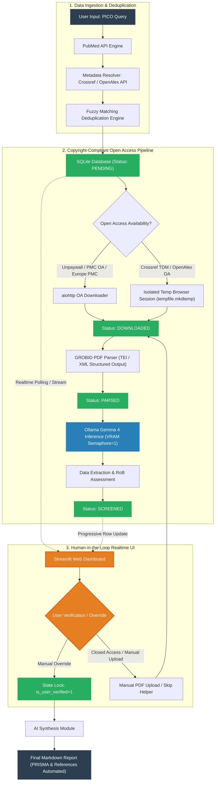

# Systematic Reviewer AI (SR-Gemma4)

    


## 개요

### Architecture Diagram


## 1. 개요

이 프로젝트는 체계적 문헌고찰(Systematic Review) 논문 작성 과정의 일부를 자동화하여 연구자의 부담을 경감시키는 AI 보조 파이프라인입니다. 로컬에서 구동되는 Ollama 기반의 Gemma 4 언어 모델을 핵심 엔진으로 사용하며, 문헌 검색, 스크리닝, 데이터 추출, 비뚤림 위험 평가(RoB), 보고서 생성 등의 모든 과정을 일원화하여 관리할 수 있습니다.

최신 버전에서는 Streamlit 기반의 직관적인 웹 UI를 통해 누구나 코딩 지식 없이 연구 파이프라인을 구동하고 결과 데이터를 세밀하게 조정(Override)할 수 있는 Human-in-the-Loop 시스템을 갖추고 있습니다.

## 2. 주요 기능 및 구성 요소

- [다중 모드 지원 (Execution Modes)]: 연구 목적에 따라 연구자가 직접 개입하며 데이터를 수정하는 `Human-in-the-Loop Mode`와, 대규모 문헌의 예비 타당성을 초고속으로 검토하는 `Full AI-driven Scoping Mode`를 분리하여 제공합니다.
- [문헌 검색 및 수집 (Ingestion)]: PubMed API를 활용하여 PICO 질문에 기반한 검색 쿼리를 자동 생성하고 문헌 메타데이터를 수집합니다.
- [자동 스크리닝 및 수동 검토 (Screening & Override)]: LLM을 활용하여 논문의 적합성을 판별합니다. AI의 판정 결과는 Streamlit 데이터 에디터를 통해 연구자가 즉시 확인하고 포함(Included)/제외(Excluded) 여부를 수동으로 변경(Override)할 수 있습니다.
- [합법적 오픈 액세스 PDF 수집 및 수동 업로드 (Copyright-Compliant OA PDF Ingestion)]: 저작권 및 출판사 이용 약관을 철저히 준수하기 위해 공식 Open Access 경로(Unpaywall API, NCBI PubMed Central OA, Europe PMC REST API, Semantic Scholar OA, Crossref TDM 라이선스 링크)만을 통해 원문 PDF를 다운로드합니다. 페이월 우회 도구나 기관 프록시 자동 스크래핑, 사용자 개인 Chrome 프로필 연동은 일절 사용하지 않으며, 브라우저 리다이렉트 처리가 필요한 경우 격리된 임시 디렉터리(`tempfile.mkdtemp()`)만 사용합니다. 자동 다운로드되지 않은 문헌은 연구자가 적법한 권한으로 확보한 뒤 수동 업로드 도우미(Manual PDF Upload Helper)를 통해 시스템에 추가할 수 있습니다.
- [PDF 구조화 파싱 (Parsing)]: GROBID를 이용해 PDF를 구조화된 TEI/XML 형식으로 변환하여 핵심 본문과 메타데이터를 추출합니다.
- [비뚤림 위험 평가 (RoB Assessment)]: 전체 텍스트(Full Text)를 분석하여 5가지 주요 영역에 대한 비뚤림 위험을 모델이 자동 평가합니다.
- [데이터 추출 (Extraction)]: PICO 프레임워크를 기반으로 연구 대상, 중재 방식, 대조군, 주요 결과 등을 추출 및 요약하여 정형화된 데이터프레임으로 제공합니다.
- [AI 종합 결론 (Synthesis)]: 추출된 정보와 RoB 평가 결과를 바탕으로 연구 질문에 대한 종합적인 결론, 근거 신뢰도, 임상적 시사점을 종합 분석(Synthesis)하여 도출합니다.
- [자동 보고서 생성 (Automated Reporting)]: 통계 데이터, PRISMA 다이어그램, AI 종합 결론, 자동 생성된 참고문헌(References) 리스트가 모두 포함된 완성형 마크다운(Markdown) 보고서를 생성 및 다운로드할 수 있습니다.

## 3. 프로젝트 구조

```text
 .
├── data/                     # 파이프라인 실행 데이터 및 SQLite DB(app_state.db) 적재
├── reference_materials/      # 실습용 리뷰 템플릿 및 참고 논문 공식 DOI 목록 (출판사 원문 PDF 미포함)
├── src/                      # 파이프라인 백엔드 코어 소스 코드
│   ├── ingest/               # 비동기 오픈 액세스 문헌 수집 및 다운로드 엔진
│   │   ├── downloader.py     # Unpaywall / PMC OA / Europe PMC / Crossref TDM 기반 합법 OA 다운로드
│   │   └── metadata_resolver.py # Crossref / OpenAlex API 연동 및 DOI 메타데이터 분석 (Polite Pool 적용)
│   ├── parse/                # GROBID 텍스트 구조화 파싱 레이어
│   ├── screen/               # 로컬 Gemma 4 추론 및 VRAM 상한 제어 (Semaphore=1)
│   ├── rob/                  # 비뚤림 위험(Risk of Bias) 자동 평가
│   ├── extract/              # PICO 프레임워크 기반 데이터 추출
│   ├── report/               # 마크다운 보고서 및 PRISMA 데이터 생성
│   └── utils/                # 공통 유틸리티 (db_manager.py: 문자열 상태 전이 및 State Lock 관리)
├── tests/                    # Pytest 기반 유닛/통합 테스트
├── app.py                    # Streamlit 웹 대시보드 (HiTL 실시간 프로그레시브 스트리밍 UI)
├── main.py                   # CLI 엔트리포인트
└── picos_config.yaml         # PICO 연구 질문 설정 파일
```

## 4. Installation & Deployment

### 4.1 개발자 환경 구축 (Python)
1. 사전 요구사항: Git, Python 3.11 이상, Docker Desktop (GROBID 구동용), Ollama.
2. Ollama 설치 후 모델 다운로드: `ollama pull gemma4`
3. GROBID 서비스 시작: 제공된 `scripts/start_services.bat` 실행
4. Python 의존성 패키지 설치 (`uv` 패키지 매니저 권장):
   ```bash
   uv pip install -r requirements.txt
   ```

### 4.2 비개발자용 간편 배포 (Docker Compose)
1. 사전 요구사항: Docker 및 Docker Compose 설치
2. 백그라운드 구동:
   ```bash
   docker-compose up -d
   ```
3. (최초 1회) Ollama 컨테이너 내부에 모델 다운로드:
   ```bash
   docker exec -it sr_ollama ollama pull gemma4
   ```
4. 웹 브라우저에서 `http://localhost:8501` 접속.

## 5. Quick Start & Usage Example

1. 앱 구동
   ```bash
   uv run streamlit run app.py --server.port 8502
   ```

2. 워크플로우 가이드 (Usage Example)
   - [사이드바 설정]: `Human-in-the-Loop` 또는 `Scoping Mode`를 선택합니다.
   - [Step 1 (Search)]: 연구 주제나 PICO 요소를 입력하고 PubMed에서 메타데이터를 검색 및 적재합니다.
   - [Step 2 (Screening)]: 수집된 논문을 바탕으로 LLM 스크리닝을 진행합니다. 결과 테이블 에디터에서 AI의 판정 결과를 확인하고 필요 시 직접 `Included`/`Excluded`를 변경(Override)할 수 있습니다.
   - [Step 3 (Analysis)]: 오픈 액세스 PDF를 다운로드 및 파싱한 후, RoB 평가와 데이터 추출을 진행합니다.
   - [Step 4 (Report)]: 최종 분석 결과를 종합하여 PRISMA 흐름도와 참고문헌이 자동 첨부된 마크다운 리포트를 생성합니다.

## 6. 사용법 (CLI)

```bash
python main.py
```
`picos_config.yaml`의 설정을 바탕으로 파이프라인을 CLI 환경에서 연속으로 수행합니다.

## 7. 수동 PDF 추가 및 검증 (Manual Helper)

자동 오픈 액세스 다운로드 대상이 아닌 구독형 논문은 연구자가 적법한 경로로 확보한 뒤 수동으로 추가할 수 있습니다.
1. 앱의 `[Manual Download Helper]` 목록에서 미확보 논문(No OA Source Found)을 확인합니다.
2. 각 논문의 공식 PubMed 또는 DOI 링크를 통해 적법한 접근 권한으로 원문 PDF를 개별 확보합니다.
3. 파일명을 `{PMID}.pdf`로 변경하여 `data/pdf/` 폴더에 위치시키거나, 브라우저의 일괄 PDF 업로드 위젯을 통해 업로드합니다.
4. 파일이 감지되면 시스템에서 자동으로 상태를 업데이트하여 후속 분석(파싱, 데이터 추출) 대상에 포함시킵니다.
5. 원문을 확보할 수 없는 문헌은 `[Skip]` 처리하여 프로세스 병목을 해소할 수 있습니다.

## 8. 데이터셋 및 소스 라이선스 (Dataset & Source License)

- [소스 코드 라이선스]: 본 프로젝트의 소스 코드는 `LICENSE` 파일에 명시된 MIT License 하에 배포됩니다.
- [외부 API 및 오픈 액세스 데이터 정책]:
  - 서지 메타데이터 및 오픈 액세스 원문 링크는 NCBI Entrez (PubMed / PMC OA), Europe PMC REST API, Unpaywall API, Crossref API, OpenAlex API, Semantic Scholar API의 공개 이용 약관(Polite Pool 및 OA 정책)을 준수하여 조회합니다.
  - 각 학술 논문의 원문 저작권은 원저자 및 해당 출판사에 귀속되며, 본 저장소는 출판사 저작물 PDF를 직접 재배포하지 않습니다(`reference_materials/README.md` 참조).

## 9. 개발 로그

본 파이프라인의 기획, 문제 해결, 설계 결정 등 상세한 개발 여정은 프로젝트 루트 디렉터리의 `development_log.txt`에 기록되어 있습니다.

## 10. Performance Benchmarks & Limitations

### 10.1 테스트 및 권장 환경
- CPU: AMD Ryzen 9 9900X (12-Core, 24-Threads) / Intel Core i5-14450HX
- GPU: NVIDIA GeForce RTX 5080 (16GB VRAM) / RTX 4060 Laptop GPU (8GB VRAM)
- RAM: 16GB ~ 64GB DDR5-5600
- OS: Windows 11 (WSL2 지원)

### 10.2 시스템 한계점 (Limitations)
- [PubMed 중심 수집]: 기본 검색은 PubMed API를 중심으로 동작하며, Embase나 Cochrane 등 외부 DB 결과는 RIS/CSV 업로드 기능을 통해 병합할 수 있습니다.
- [오픈 액세스 범위 준수]: 유료 구독이 필요한 Closed Access 논문은 자동 크롤링하지 않으며, 연구자의 수동 업로드를 통해서만 분석에 포함됩니다.
- [RoB 자동 평가 검증 필요]: 자동 비뚤림 평가는 보조 제안이므로 반드시 연구자의 교차 검증(Human-in-the-Loop)을 권장합니다.

## 11. References

- Page, M. J., McKenzie, J. E., Bossuyt, P. M., Boutron, I., Hoffmann, T. C., Mulrow, C. D., ... & Moher, D. (2021). The PRISMA 2020 statement: an updated guideline for reporting systematic reviews. BMJ, 372, n71. https://doi.org/10.1136/bmj.n71
- Sterne, J. A., Savovic, J., Page, M. J., Elbers, R. G., Blencowe, N. S., Boutron, I., ... & Higgins, J. P. (2019). RoB 2: a revised tool for assessing risk of bias in randomised trials. BMJ, 366, l4898. https://doi.org/10.1136/bmj.l4898
- GROBID (GeneRation Of BIbliographic Data). (2008-2024). https://github.com/kermitt2/grobid

## 설치 및 실행 방법
```bash
pip install -r requirements.txt
```

## 가중치 파일 안내
본 모듈은 가중치 모델이 불필요한 룰베이스/인프라/기하학 모듈이므로, 별도의 딥러닝 가중치 파일이 요구되지 않습니다.

## 연구용 실행 주의사항
- 기본 실행 주소: 127.0.0.1 (로컬 전용)
- 외부 공개/상용 배포 금지
- API 키·토큰은 환경변수로만 관리
- 오픈 데이터셋 외 민감 의료데이터 사용 금지
- 외부 접근이 필요하면 ALLOW_EXTERNAL_ACCESS=true 로만 명시적 허용
